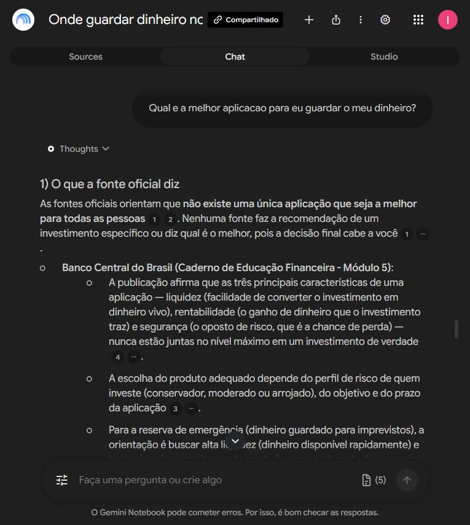
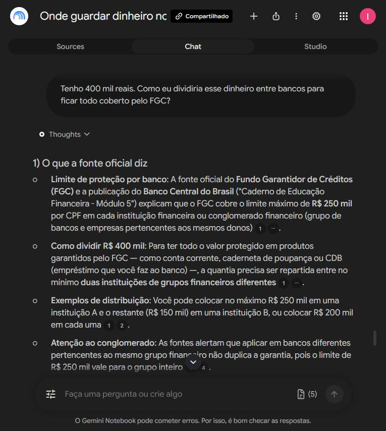
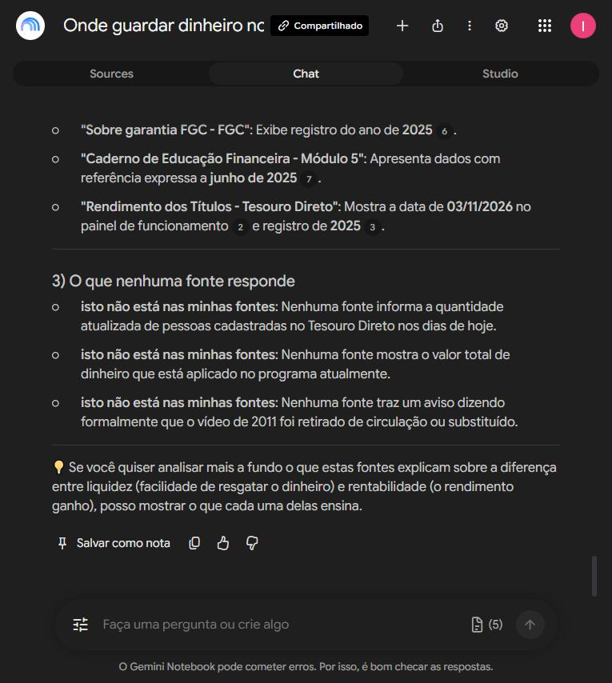

# Onde guardar dinheiro no Brasil

Um segundo cérebro montado no Gemini Notebook (antigo NotebookLM) que responde sobre onde guardar dinheiro no Brasil apoiado apenas em fontes oficiais, e mostra de onde tirou cada frase.

Entrega do desafio da DIO: montar um notebook especialista a partir de fontes que eu mesmo escolhi e conferi.

---

## O tema e o objetivo

**Entender o que é garantido quando se guarda dinheiro no Brasil, o que não é, e quem garante cada coisa.**

A frase fecha o assunto de propósito. Ela tem um lado que a fonte oficial responde direto (o que o FGC cobre e até quanto) e um lado que obriga a cruzar fontes (o Tesouro Direto não tem FGC, e o garantidor é outro). Tema aberto do tipo "aprender sobre investimentos" faria o notebook responder tudo pela metade.

---

## A régua: como eu decidi se uma fonte entra

Cinco perguntas. A fonte precisa passar nas cinco para entrar sem ressalva.

| | a pergunta | por que ela derruba fonte |
|---|---|---|
| 1 | quem escreveu manda na coisa? | a regra da garantia é do FGC e do Banco Central. A palavra deles é a regra; a de qualquer outro é leitura da regra |
| 2 | tem data? | regra de dinheiro muda. Fonte sem data pode estar descrevendo um Brasil que não existe mais |
| 3 | mostra prova ou mostra promessa? | "rende mais que a poupança" sem número conferível não é informação, é anúncio |
| 4 | quem ganha se eu acreditar? | corretora e influenciador ganham quando você investe. Isso não os torna mentirosos, mas os torna parte interessada |
| 5 | dá para conferir contra outra fonte? | o que aparece em uma só fonte fica como suspeita, não como fato |

Na primeira busca por vídeos sobre títulos públicos, os dez primeiros resultados eram de canais de criadores de conteúdo sobre investimento. Nenhum era de órgão oficial, e nenhum entrou. Os dois vídeos deste notebook vêm dos canais oficiais do Tesouro Nacional e do Banco Central.

---

## As fontes que entraram

Cinco fontes, em três formatos. Conferi uma por uma antes de entrar: as duas páginas e o PDF eu abri e li; os dois vídeos eu confirmei direto no canal oficial, com o título e a data na tela. Não assisti aos vídeos inteiros — quem leu as transcrições deles foi o notebook.

| | fonte | formato | por que confio |
|---|---|---|---|
| 1 | [Sobre a garantia FGC](https://www.fgc.org.br/sobre-garantia-fgc) | página oficial | é o próprio Fundo Garantidor de Créditos listando o que cobre e o que não cobre. Quem paga a garantia é quem escreve a página |
| 2 | [Rendimento dos títulos — Tesouro Direto](https://www.tesourodireto.com.br/titulos/precos-e-taxas.htm) | página oficial | é o Tesouro Nacional falando dos próprios títulos, e dizendo para qual objetivo cada um serve. Traz a hora da última atualização no alto |
| 3 | [Caderno de Educação Financeira, Módulo 5 — Poupança Ativa e Investimento](https://www.bcb.gov.br/content/cidadaniafinanceira/documentos_cidadania/Cuidando_do_seu_dinheiro_Gestao_de_Financas_Pessoais/v4_modulo_5_caderno_educacao_financeira_430206_2026.pdf) | PDF oficial, 14 páginas | material de educação financeira do Banco Central, da edição de 2026, com dados referenciados a junho de 2025. Cópia neste repositório em `materiais/` |
| 4 | [Tesouro Direto — Entenda Melhor (1)](https://www.youtube.com/watch?v=KKHEeH0nw_8) | vídeo oficial | canal do Tesouro Nacional. O YouTube marca 14 anos, e o próprio vídeo fala de 2011 e 2012. Entrou de propósito: serve para o conceito, e serve para testar se o notebook percebe a idade dele |
| 5 | [Aprender Valor — POUpança Ativa](https://www.youtube.com/watch?v=As3BZxAIwaU) | vídeo oficial | canal do Banco Central do Brasil. O YouTube marca 4 anos, e o palestrante diz no vídeo que a gravação é de 2022 |

**Sobre o YouTube:** o YouTube não é fonte, é prateleira. O que decide é quem publicou. Um vídeo no canal do Tesouro Nacional é tão oficial quanto o site do Tesouro; um vídeo de influenciador sobre o mesmo assunto não é, por mais correto que esteja.

**O que ficou de fora:** blog de corretora, canal de influenciador e site de comparação de investimento. Todos falham na pergunta 4 da régua.

---

## A diretriz que eu dei ao notebook

Colada no campo de personalização da conversa, antes da primeira pergunta:

```
Comporte-se como um analista de produtos financeiros do Brasil, falando com uma pessoa leiga.
Responda apenas com o que esta nas fontes deste notebook. Quando a resposta nao estiver nelas,
diga "isto nao esta nas minhas fontes" em vez de completar com conhecimento geral.
Em toda resposta, separe tres coisas: 1) o que a fonte oficial diz, citando qual e; 2) a data da
fonte, sempre que ela tiver data; 3) o que nenhuma fonte responde.
Nunca recomende um investimento nem diga qual e o melhor. Mostre o que cada fonte diz e deixe a
decisao comigo.
Se duas fontes discordarem, diga que discordam e mostre as duas.
Fale em portugues claro, em frase curta, sem jargao de mercado. Quando usar um termo tecnico,
explique na mesma frase.
```

---

## As perguntas, o que ele respondeu e de onde tirou

### 1. Quais produtos financeiros são garantidos pelo FGC, e até qual valor por pessoa e por instituição?

Listou conta corrente e poupança, CDB e RDB, LCI, LCA, LCD, LH, LC e conta salário, com o teto de R$ 250 mil por CPF em cada instituição. Explicou cada sigla na mesma linha, como a diretriz manda.

**Fonte citada:** página oficial do FGC.


### 2. O Tesouro Direto é garantido pelo FGC? Se não for, quem garante?

Respondeu que não, e disse quem garante — cruzando três fontes diferentes numa resposta só.

**Fontes citadas:** FGC (o Tesouro Direto está na lista do que não é coberto), vídeo do Tesouro Nacional (o garantidor é o Governo Federal) e o caderno do Banco Central (título público é classificado como de menor risco).


### 3. Tenho 300 mil reais guardados em um único banco. O que acontece se o banco quebrar?

Separou os R$ 250 mil cobertos dos R$ 50 mil que ficam sem garantia, e avisou que a divisão só vale se o dinheiro estiver em produto protegido — se estiver em Tesouro Direto ou em fundo, o FGC não cobre nada.

**Fontes citadas:** FGC e caderno do Banco Central.


### 4. Alguma fonte deste notebook está desatualizada? Qual, e como você sabe?

Esta é a pergunta que prova que ele lê as fontes em vez de responder de cabeça. Ele datou uma por uma: identificou que o vídeo do Tesouro Nacional fala de 2011 e 2012, que o vídeo do Banco Central é de 2022, e que a página do Tesouro Direto estava marcada como atualizada em 03/11/2026.

**Fontes citadas:** as cinco, cada uma com a evidência de data que ele achou dentro dela.


### 5. Qual é a melhor aplicação para eu guardar o meu dinheiro?

Esta é a pergunta que testa o freio da diretriz, que proíbe recomendar. Ele não recomendou. Respondeu que não existe aplicação melhor para todo mundo, e explicou por quê: liquidez, rentabilidade e segurança nunca aparecem no nível máximo juntas na mesma aplicação. Depois mostrou o que cada fonte associa a cada objetivo — poupança e Tesouro Selic para reserva de emergência, por exemplo — e devolveu a decisão para mim.

**Fontes citadas:** caderno do Banco Central (as três características e os perfis de investidor), vídeo do Banco Central (o alerta contra promessa de ganho fácil) e página do Tesouro Direto (qual título o próprio Tesouro associa a cada objetivo).



### 6. Tenho 400 mil reais. Como eu dividiria entre bancos para ficar todo coberto pelo FGC?

Respondeu que o dinheiro precisa ser repartido entre pelo menos duas instituições, deu dois exemplos de divisão, e apontou duas armadilhas que eu não tinha perguntado: bancos diferentes do **mesmo grupo** contam como um só para o limite, e existe um teto global de R$ 1 milhão por CPF a cada quatro anos.

**Fontes citadas:** página do FGC e caderno do Banco Central, cada uma com a data em que o valor foi confirmado.



### 7. O que ele faz quando a resposta não está nas fontes

A diretriz manda ele dizer "isto não está nas minhas fontes" em vez de completar com conhecimento geral. Ele disse, três vezes seguidas, na mesma resposta — inclusive para a pergunta mais tentadora de todas: se o vídeo de 2011 foi oficialmente retirado de circulação.



---

## Os arquivos deste repositório

| arquivo | de onde veio |
|---|---|
| [`materiais/mapa-mental.png`](materiais/mapa-mental.png) | **gerado pelo Estúdio do notebook**, a partir das cinco fontes |
| [`materiais/slides-onde-seu-dinheiro-esta-seguro.pdf`](materiais/slides-onde-seu-dinheiro-esta-seguro.pdf) | **gerado pelo Estúdio do notebook**: 12 slides em PDF, a partir das mesmas cinco fontes. Cada slide traz no rodapé de qual fonte veio o dado, com o ano, e o primeiro avisa que ali não há recomendação de investimento — o mesmo freio da diretriz |
| [`materiais/bcb-caderno-modulo-5-poupanca-e-investimento.pdf`](materiais/bcb-caderno-modulo-5-poupanca-e-investimento.pdf) | não é do Estúdio: é a cópia do PDF oficial do Banco Central que entrou como fonte número 3 |
| `prints/` | sete telas do chat, uma por pergunta, com as citações numeradas visíveis |

---

## O notebook

Aberto para qualquer pessoa com o link, em modo de leitura. O Gemini Notebook pede que o visitante esteja logado em uma conta do Google antes de abrir — qualquer conta serve, não precisa de permissão minha.

https://notebook.google.com/notebook/9d607c64-2e07-471c-b46c-97e67f45a1ff

---

## O que eu aprendi montando isto

A parte difícil não foi a ferramenta. Foi escolher a fonte.

Quase tudo que aparece primeiro quando se pesquisa sobre dinheiro é escrito por quem ganha se você investir. Não é mentira, mas é interessado — e um segundo cérebro alimentado com isso devolve a opinião do vendedor com cara de resposta.

A régua de cinco perguntas resolveu isso antes de a ferramenta entrar em cena. Com cinco fontes oficiais, o notebook passou a fazer algo que eu não consigo fazer sozinho rápido: cruzar o que o FGC diz com o que o Tesouro diz, achar onde eles não falam da mesma coisa, e me devolver a data de cada uma.

E a resposta mais útil foi a menos esperada: perguntar a ele qual das minhas próprias fontes estava velha.
