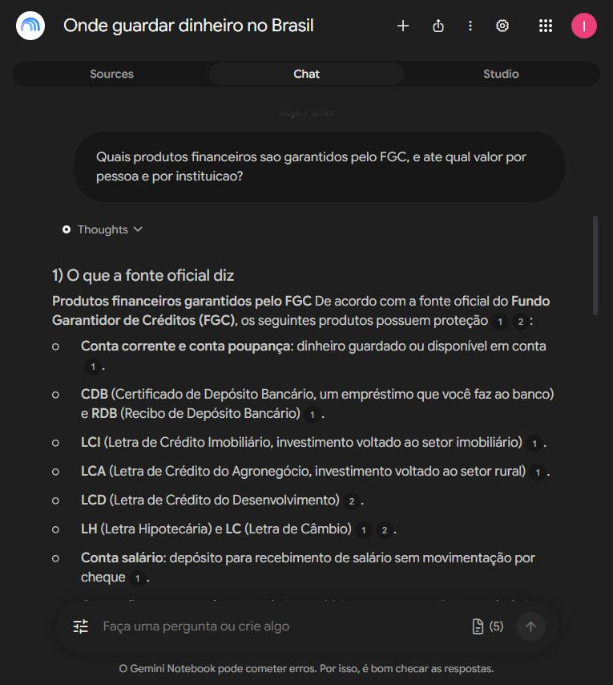
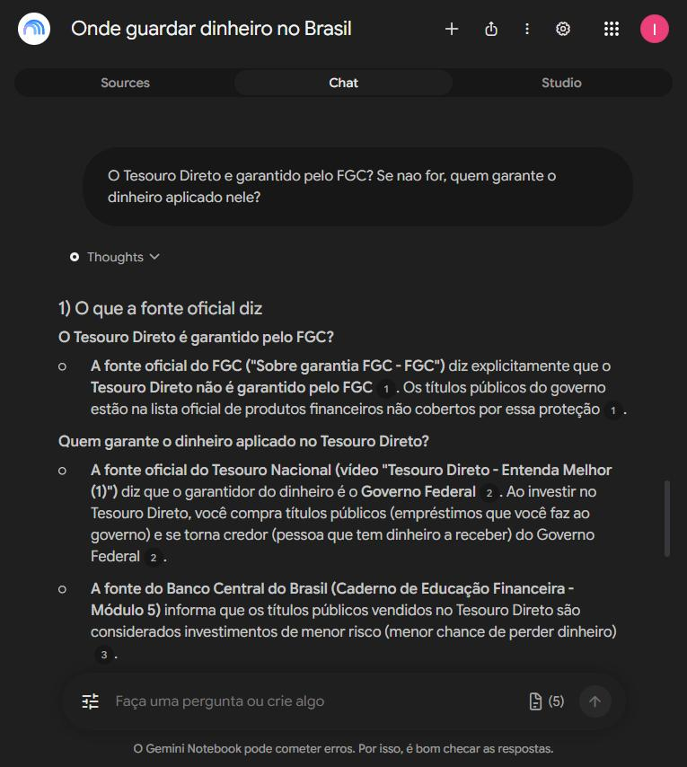
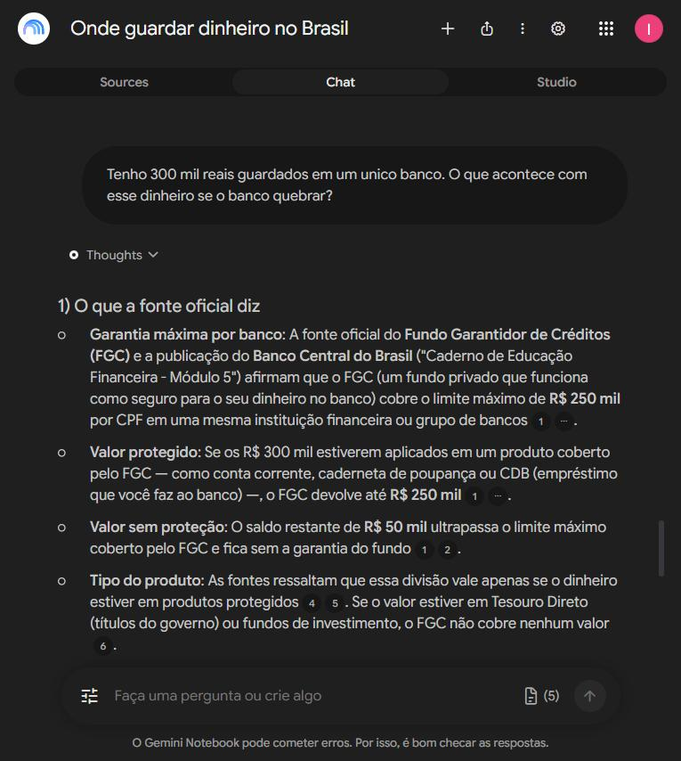
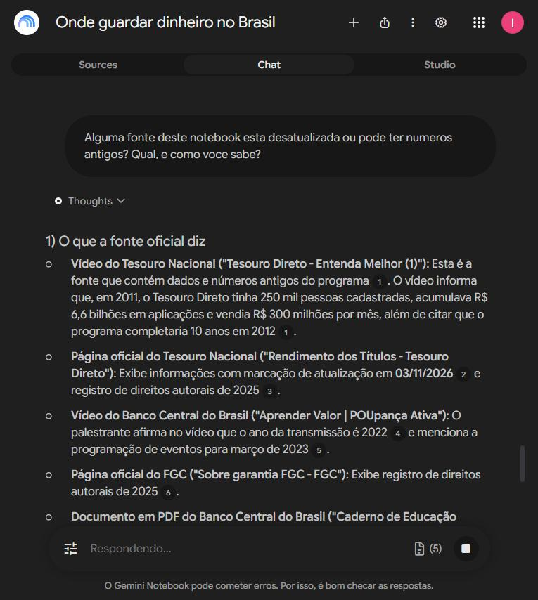

# Onde guardar dinheiro no Brasil

Um segundo cérebro montado no Gemini Notebook (antigo NotebookLM) que responde sobre onde guardar dinheiro no Brasil apoiado apenas em fontes oficiais, e mostra de onde tirou cada frase.

Desafio da DIO — Entendendo o Desafio: montar um notebook especialista a partir de fontes que eu mesmo escolhi e conferi.

---

## O tema e o objetivo

**Entender o que é garantido quando se guarda dinheiro no Brasil, o que não é, e quem garante cada coisa.**

A frase fecha o assunto de propósito. Ela tem um lado que a fonte oficial responde direto (o que o FGC cobre e até quanto) e um lado que obriga a cruzar fontes (o Tesouro Direto não tem FGC, e o garantidor é outro). Tema aberto do tipo "aprender sobre investimentos" faria o notebook responder tudo pela metade.

---

## A régua: como eu decidi se uma fonte entra

Cinco perguntas. A fonte precisa passar nas cinco para entrar sem ressalva.

| | a pergunta | por que ela derruba fonte |
|---|---|---|
| 1 | quem escreveu manda na coisa? | a regra da garantia é do FGC e do Banco Central. A palavra deles é a regra; a de qualquer outro é leitura da regra |
| 2 | tem data? | regra de dinheiro muda. Fonte sem data pode estar descrevendo um Brasil que não existe mais |
| 3 | mostra prova ou mostra promessa? | "rende mais que a poupança" sem número conferível não é informação, é anúncio |
| 4 | quem ganha se eu acreditar? | corretora e influenciador ganham quando você investe. Isso não os torna mentirosos, mas os torna parte interessada |
| 5 | dá para conferir contra outra fonte? | o que aparece em uma só fonte fica como suspeita, não como fato |

Na primeira busca por vídeos sobre títulos públicos, os dez primeiros resultados eram de canais que vendem curso ou assessoria. Nenhum entrou. Os dois vídeos deste notebook vêm dos canais oficiais do Tesouro Nacional e do Banco Central.

---

## As fontes que entraram

Cinco fontes, em três formatos, todas abertas e lidas por mim antes de entrar.

| | fonte | formato | por que confio |
|---|---|---|---|
| 1 | [Sobre a garantia FGC](https://www.fgc.org.br/sobre-garantia-fgc) | página oficial | é o próprio Fundo Garantidor de Créditos listando o que cobre e o que não cobre. Quem paga a garantia é quem escreve a página |
| 2 | [Rendimento dos títulos — Tesouro Direto](https://www.tesourodireto.com.br/titulos/precos-e-taxas.htm) | página oficial | é o Tesouro Nacional publicando preço e taxa dos próprios títulos |
| 3 | [Caderno de Educação Financeira, Módulo 5 — Poupança Ativa e Investimento](https://www.bcb.gov.br/content/cidadaniafinanceira/documentos_cidadania/Cuidando_do_seu_dinheiro_Gestao_de_Financas_Pessoais/v4_modulo_5_caderno_educacao_financeira_430206_2026.pdf) | PDF oficial, 14 páginas | material de educação financeira do Banco Central, edição de 2026. Cópia neste repositório em `materiais/` |
| 4 | [Tesouro Direto — Entenda Melhor (1)](https://www.youtube.com/watch?v=KKHEeH0nw_8) | vídeo oficial | canal do Tesouro Nacional. É velho, de 2011, e entrou de propósito: serve para o conceito, e serve para testar se o notebook percebe a idade dele |
| 5 | [Aprender Valor — POUpança Ativa](https://www.youtube.com/watch?v=As3BZxAIwaU) | vídeo oficial | canal do Banco Central do Brasil, de 2022 |

**Sobre o YouTube:** o YouTube não é fonte, é prateleira. O que decide é quem publicou. Um vídeo no canal do Tesouro Nacional é tão oficial quanto o site do Tesouro; um vídeo de influenciador sobre o mesmo assunto não é, por mais correto que esteja.

**O que ficou de fora:** blog de corretora, canal de influenciador e site de comparação de investimento. Todos falham na pergunta 4 da régua.

---

## A diretriz que eu dei ao notebook

Colada no campo de personalização da conversa, antes da primeira pergunta:

```
Comporte-se como um analista de produtos financeiros do Brasil, falando com uma pessoa leiga.
Responda apenas com o que esta nas fontes deste notebook. Quando a resposta nao estiver nelas,
diga "isto nao esta nas minhas fontes" em vez de completar com conhecimento geral.
Em toda resposta, separe tres coisas: 1) o que a fonte oficial diz, citando qual e; 2) a data da
fonte, sempre que ela tiver data; 3) o que nenhuma fonte responde.
Nunca recomende um investimento nem diga qual e o melhor. Mostre o que cada fonte diz e deixe a
decisao comigo.
Se duas fontes discordarem, diga que discordam e mostre as duas.
Fale em portugues claro, em frase curta, sem jargao de mercado. Quando usar um termo tecnico,
explique na mesma frase.
```

---

## As perguntas, o que ele respondeu e de onde tirou

### 1. Quais produtos financeiros são garantidos pelo FGC, e até qual valor por pessoa e por instituição?

Listou conta corrente e poupança, CDB e RDB, LCI, LCA, LCD, LH, LC, conta salário e operações compromissadas, com o teto de R$ 250 mil por CPF em cada instituição.

**Fonte citada:** página oficial do FGC.



### 2. O Tesouro Direto é garantido pelo FGC? Se não for, quem garante?

Respondeu que não, e disse quem garante — cruzando três fontes diferentes numa resposta só.

**Fontes citadas:** FGC (o Tesouro Direto está na lista do que não é coberto), vídeo do Tesouro Nacional (o garantidor é o Governo Federal) e o caderno do Banco Central (título público é classificado como de menor risco).



### 3. Tenho 300 mil reais guardados em um único banco. O que acontece se o banco quebrar?

Separou os R$ 250 mil cobertos dos R$ 50 mil que ficam sem garantia, e avisou que a divisão só vale se o dinheiro estiver em produto protegido — se estiver em Tesouro Direto ou em fundo, o FGC não cobre nada.

**Fontes citadas:** FGC e caderno do Banco Central.



### 4. Alguma fonte deste notebook está desatualizada? Qual, e como você sabe?

Esta é a pergunta que prova que ele lê as fontes em vez de responder de cabeça. Ele datou uma por uma: identificou que o vídeo do Tesouro Nacional fala de 2011 e 2012, que o vídeo do Banco Central é de 2022, e que a página do Tesouro Direto estava marcada como atualizada em 03/11/2026.

**Fontes citadas:** as cinco, cada uma com a evidência de data que ele achou dentro dela.



---

## O que o Estúdio gerou

| arquivo | o que é |
|---|---|
| [`materiais/mapa-mental.png`](materiais/mapa-mental.png) | mapa mental montado a partir das cinco fontes |
| [`materiais/bcb-caderno-modulo-5-poupanca-e-investimento.pdf`](materiais/bcb-caderno-modulo-5-poupanca-e-investimento.pdf) | cópia do PDF oficial do Banco Central que entrou como fonte |

---

## O notebook

https://notebook.google.com/notebook/9d607c64-2e07-471c-b46c-97e67f45a1ff

---

## O que eu aprendi montando isto

A parte difícil não foi a ferramenta. Foi escolher a fonte.

Quase tudo que aparece primeiro quando se pesquisa sobre dinheiro é escrito por quem ganha se você investir. Não é mentira, mas é interessado — e um segundo cérebro alimentado com isso devolve a opinião do vendedor com cara de resposta.

A régua de cinco perguntas resolveu isso antes de a ferramenta entrar em cena. Com cinco fontes oficiais, o notebook passou a fazer algo que eu não consigo fazer sozinho rápido: cruzar o que o FGC diz com o que o Tesouro diz, achar onde eles não falam da mesma coisa, e me devolver a data de cada uma.

E a resposta mais útil foi a menos esperada: perguntar a ele qual das minhas próprias fontes estava velha.
